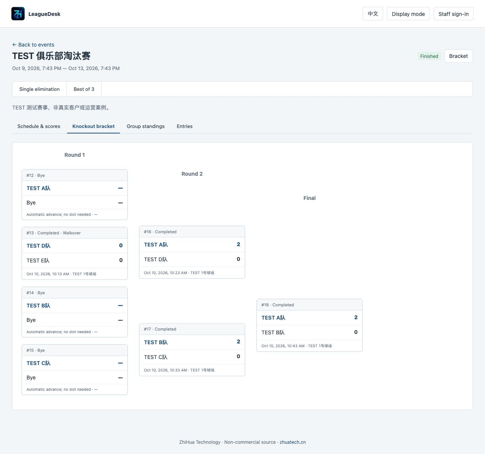

[简体中文](README.md) · [English](README.en.md)

# LeagueDesk · Sports Tournament and League Management

ZhiHua Technology (Shanghai Rujing Zhihua Information Technology Co., Ltd.) · [Official website](https://www.zhuatech.cn/)

LeagueDesk manages registration, review, check-in, group round robins, knockout qualification, court and referee scheduling, set-based results, and local season standings for clubs and community racket events. Organizer, entrant-owner, referee and public views use the same persistent backend. Java 21 / Spring Boot 4 / Vue 3 / MySQL 8.4.

**Public source for personal learning and non-commercial research.** Commercial use requires prior written authorization from Shanghai Rujing Zhihua Information Technology Co., Ltd. This is not an OSI open-source license or a free commercial license. See [LICENSE](LICENSE).

## Use cases and boundaries

- Clubs and venues running events with 2–64 entrants across several courts and seasons.
- Community or campus events where account holders enter and staff review, seed and check them in.
- Public event links showing approved display names, schedules, results, group rankings and knockout brackets without sign-in; optional large-screen display.

Each entrant is one individual or team registration unit owned by one account. Team names are supported, but **lineups, singles/doubles rubbers and individual team rosters are not implemented**. Scores are sets won: best of 3, 5 or 7. There is no point-by-point scoring or football table. Groups contain 2–16 entrants, ranked by wins, set difference, sets won and original seed. These local rules may differ from sports federation rules.

## Implemented functions

| View | Available operations |
|---|---|
| Organizer | Seasons, courts, event drafts; open registration; enter an account holder; review, seed and check in; generate group or direct knockout draws; assign court, referee and times; advance qualifiers; correct results; cancel or finish; publish or unpublish; export match CSV |
| Entrant owner | Sign in; enter open events in the account organization; see own review/check-in state; withdraw during registration; view own event results; no review of other entrants or account administration |
| Referee | Assigned-match desk; start scheduled matches; submit set scores or walkovers; no editing submitted results or scoring another referee's matches |
| Administrator | All business operations plus accounts, role permissions, organizations, event categories, menus, limits, own-password changes and audit |
| Public | Published events, approved display names, schedules, results, group standings and knockout brackets; large-screen mode and 15-second refresh; no owner account IDs, private notes or audit |

Odd round robins rotate byes. Knockout draws pad to a power of two and propagate automatic byes. Qualification requires all group results. Changing a knockout winner resets affected unstarted downstream assignments; correction is blocked once a downstream match has started. Finished results are frozen. Court, referee and owner-account time conflicts are checked across events, with adjoining slots allowed and validity rechecked on start.

Commands use transactions, record versions and UUID idempotency keys. Exact retries cannot create duplicate draws or qualification. Disabled accounts/organizations and role changes affect subsequent requests. Only finished events contribute season points: champion 5, runner-up 3, other drawn entrants 1. These are local points, not official ratings.

## Actual running screens

These screens use an isolated database and explicitly marked `TEST` fixtures, not customer cases. A fresh installation contains no business fixtures.

| Screen | Function |
|---|---|
| Login | Account sign-in and public event entry |
| Organizer home | Event search, status filters and draft management |
| Schedule / referee | Assign matches and process own referee results |
| Entries | Review, seeding and check-in |
| Reports | Season points from finished events |
| Roles / accounts | Permissions, scopes and account administration |
| Public bracket / mobile | Shareable brackets and responsive public view |





## Architecture and directory layout

Browser → Nginx same-origin proxy → Spring Boot sessions/business API → MySQL. Vue loads actual backend records. Flyway performs versioned migrations; JPA validates the schema instead of creating it. Critical writes use a database lock, suitable for smaller events rather than a distributed high-throughput platform.

```text
backend/src/main/java/cn/zhuatech/leaguedesk/  Identity, permissions, event service
backend/src/main/resources/db/migration/    V1 identity and V2 event schema
backend/src/test/                           Draw and HTTP integration tests
frontend/src/                              Chinese / English interface
frontend/public/brand/                     Official logo and Chinese contact assets
scripts/                                   Setup, HTTP tests, backup, restore, release checks
compose.yaml                               MySQL, backend, frontend
compose.dev.yaml                           Local-only database debug port
.github/workflows/verify.yml                Builds, real MySQL tests, restore checks
docs/                                      Operations, API, deployment, security, screenshots
```

## Requirements, installation and database initialization

Recommended: Docker Engine 27+ or Docker Desktop, Compose v2 supporting `--wait`, 4 GB available memory and at least 4 GB disk. Local source development requires JDK 21, Maven 3.9+, Node.js **24.19.0+**, npm and MySQL 8.4. Container builds use Java 21 and Node 24.19.0.

```bash
git clone https://github.com/zhuatech-han/zhuatech-leaguedesk.git
cd zhuatech-leaguedesk
python3 scripts/init-env.py
docker compose -p leaguedesk config --quiet
docker compose -p leaguedesk up -d --build --wait --wait-timeout 180
```

Open <http://127.0.0.1:8144/>. Health: <http://127.0.0.1:8144/actuator/health>. Initial username is `admin`; read the generated `ADMIN_PASSWORD` from your private `.env`. **There is no shared default password.** Never publish the file or reveal the password in screenshots.

V1/V2 create the schema. Bootstrap adds an organization, four roles, permissions, menus, one event category, limits and the initial administrator. **It does not create events, entrants or referee accounts.** Create entrant/referee accounts, seasons and courts, then an event. The [operations guide](docs/OPERATIONS.md) explains the order. Restarting an existing database does not reset the password. Never edit applied migrations; add a new version for schema changes.

## Configuration and local development

| Variable | Meaning |
|---|---|
| `MYSQL_ROOT_PASSWORD`, `DATABASE_PASSWORD` | Required independent strong database passwords |
| `ADMIN_USERNAME`, `ADMIN_PASSWORD` | Initial administrator; password 12–72 bytes, upper/lowercase and a digit |
| `WEB_PORT` | Default 8144; edit `.env` or use `WEB_PORT=8150 docker compose -p leaguedesk up -d` |
| `BIND_ADDRESS` | Default `127.0.0.1`, local only |
| `COOKIE_SECURE` | false for local HTTP; true behind a proper HTTPS proxy |
| `DATABASE_URL`, `DATABASE_USER` | Optional external MySQL; require trusted CA and hostname verification |
| `MYSQL_DEV_PORT` | Development override only, default localhost 33144 |

```bash
docker compose -p leaguedesk-dev -f compose.yaml -f compose.dev.yaml up -d mysql
python3 scripts/dev-backend.py
# A separate terminal:
cd frontend
npm ci --no-audit --no-fund
npm run dev
```

Vite uses port 5173 and proxies local backend 8080. Production Nginx uses the backend container service name. Do not expose the debug database port publicly.

## Tests

```bash
mvn -B -f backend/pom.xml spotless:check verify
npm --prefix frontend ci --no-audit --no-fund
npm --prefix frontend run format:check
npm --prefix frontend run lint
npm --prefix frontend test
npm --prefix frontend run build
python3 scripts/release-check.py
```

There are 6 backend algorithm/input tests, 19 integration tests and 9 frontend CSRF/session/network tests. Separate real-MySQL acceptance creates marked `TEST` data and accounts: **run it only against a dedicated empty localhost database**, never an operational database.

```bash
python3 scripts/quality.py --base http://127.0.0.1:8144
# After restart, compare complete snapshots:
docker compose -p leaguedesk restart backend
docker compose -p leaguedesk up -d --wait --wait-timeout 180
python3 scripts/verify-persistence.py
```

Backend Docker builds execute tests; they are not skipped. See [test coverage](docs/TESTING.md).

## Deployment, backup and restore

Use a real domain, HTTPS reverse proxy, private database networking and `COOKIE_SECURE=true`; configure rate limits, log rotation, storage monitoring and secure backups. Local acceptance is not production certification. See [deployment](docs/DEPLOYMENT.md) and [security](docs/SECURITY.md).

```bash
python3 scripts/backup.py --project leaguedesk --output /private/path/leaguedesk-backup.zip
# New isolated target only; restore.env must specify a different WEB_PORT:
python3 scripts/restore.py /private/path/leaguedesk-backup.zip --project leaguedesk-restore --env-file /private/path/restore.env
```

Backup briefly stops backend writes and restarts it automatically. Archives contain database password hashes and private records; protect them. Restore refuses existing containers, network or volumes. Only use trusted backups. `docker compose -p leaguedesk-test down -v` deletes that test project's database; operational `stop` or `down` retains the volume.

## Known limitations and third-party setup

- No automated scheduling, Swiss/double elimination, team lineup or point scoring, federation ratings or official integration.
- No SMS, fee collection/payments, livestreaming, scoreboard hardware, offline synchronization, multi-company SaaS, self-sign-up or email password recovery. Organizers create accounts; anonymous visitors can only browse published events.
- Times are UTC in storage and browser-local on screen. Check the timezone shown when scheduling.
- Executed events retain history. No deletion or unrestricted rollback of completed events; group results lock after qualification and upstream results lock once a dependent match starts.
- Maximum 64 drawn units, 16 per group, serialized writes. Large-scale load and external penetration tests have not been performed.
- Directory queries cap at 10,000 records and audit returns the most recent 1,000. Large deployments need tailored server-side pagination, archival and retention.
- Core business requires no SMS or payment credentials. Operational deployment still needs a domain, TLS, reliable MySQL and backups. Unimplemented external integrations are not claimed as complete.

## Licensing, dependencies and contact

Own code is restricted by [LICENSE](LICENSE) to personal learning, technical research and non-commercial exchange. Commercial licensing, enterprise deployment, resale and paid services require prior written authorization. Third-party dependencies retain their own copyright/licenses; see [third-party notices](docs/THIRD_PARTY.md).

[ZhiHua Technology website](https://www.zhuatech.cn/) · Source licensing, customization, deployment and system integration:

- Email: [han@zhuatech.cn](mailto:han@zhuatech.cn)
- Email: [jack@zhuatech.cn](mailto:jack@zhuatech.cn)
- WhatsApp: [+86 17521234993](https://wa.me/8617521234993)
