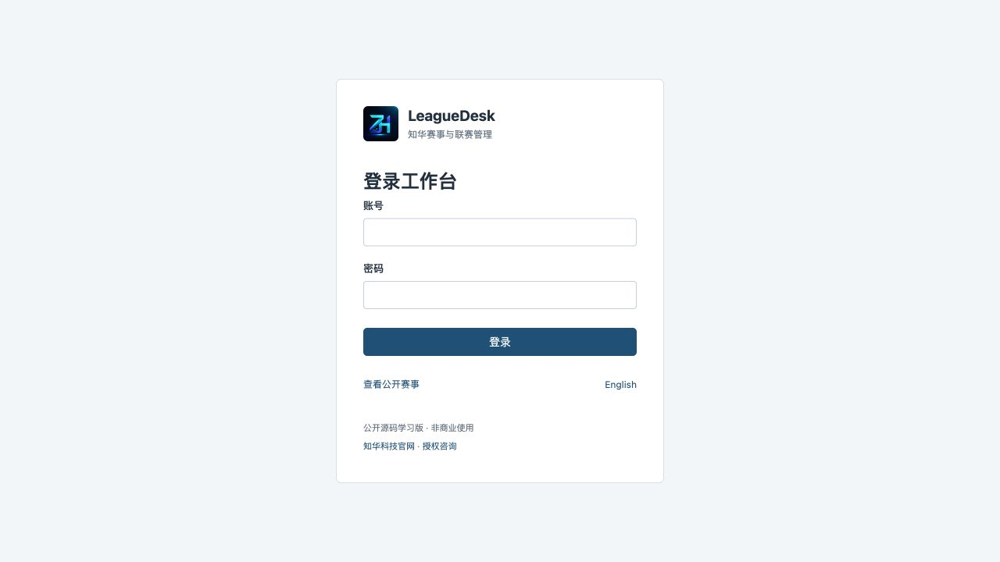
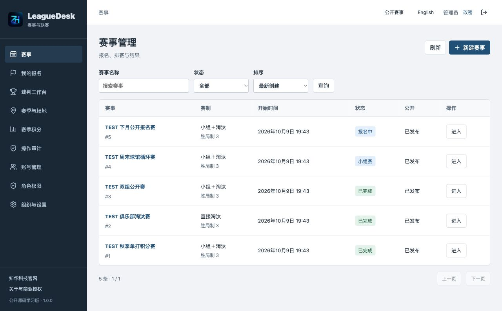
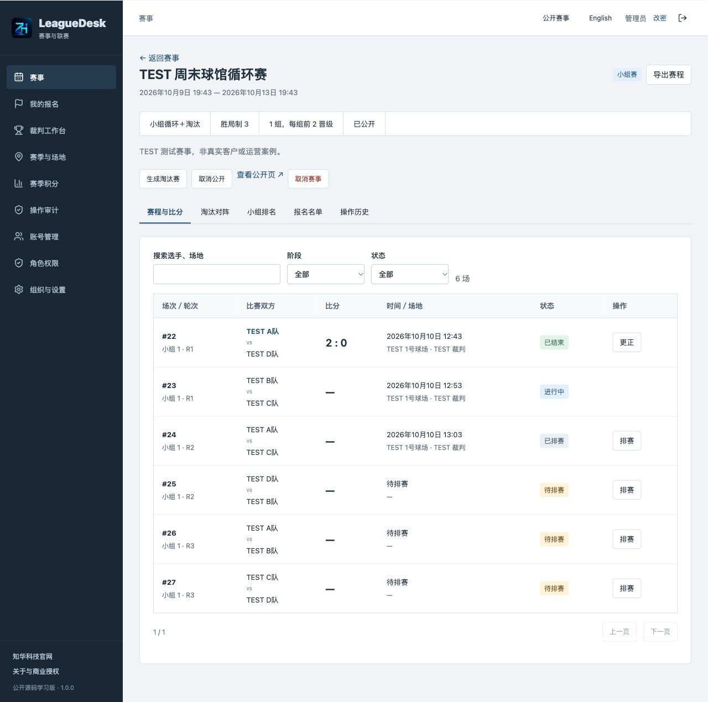
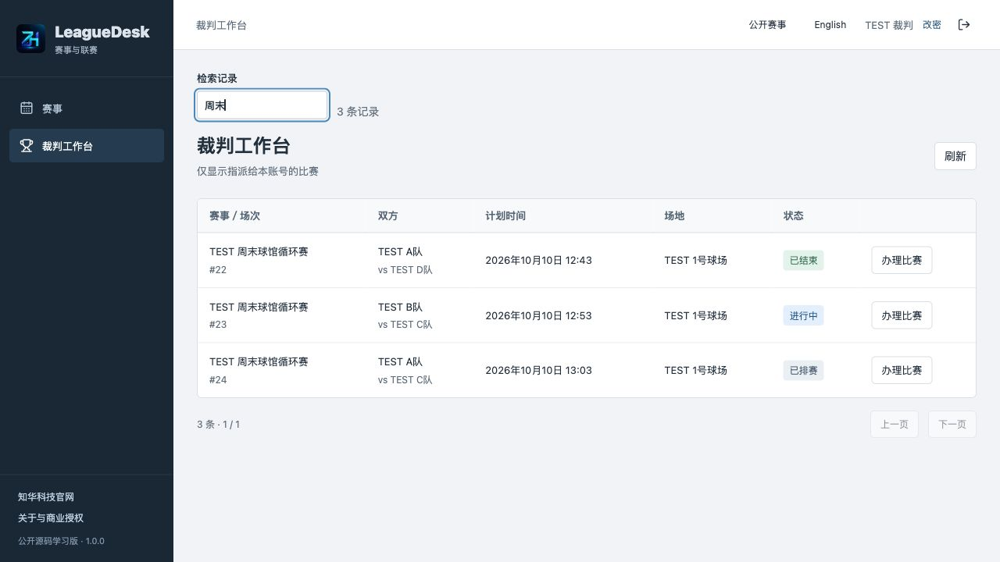
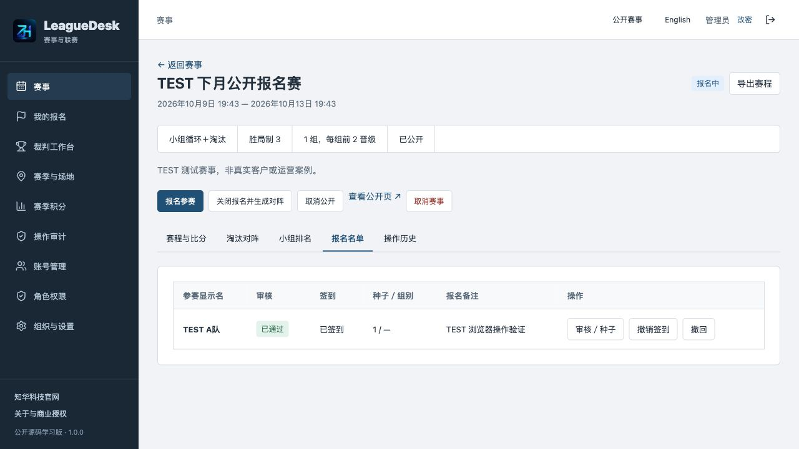
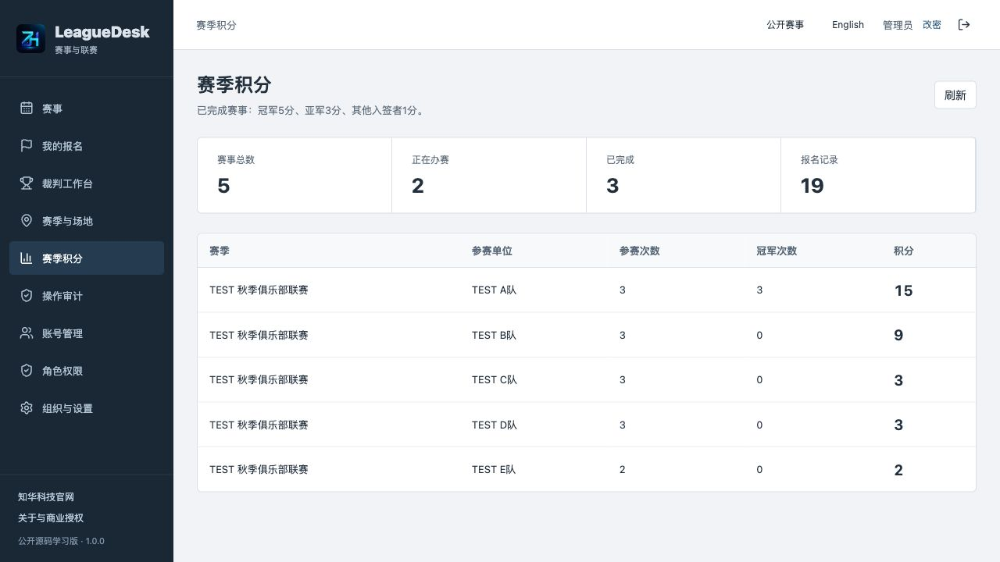
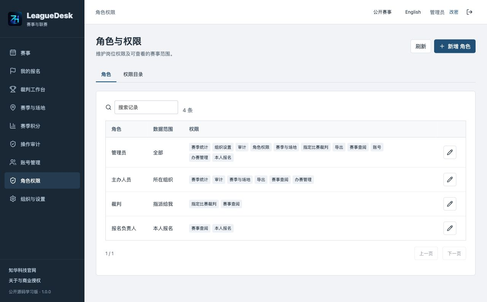
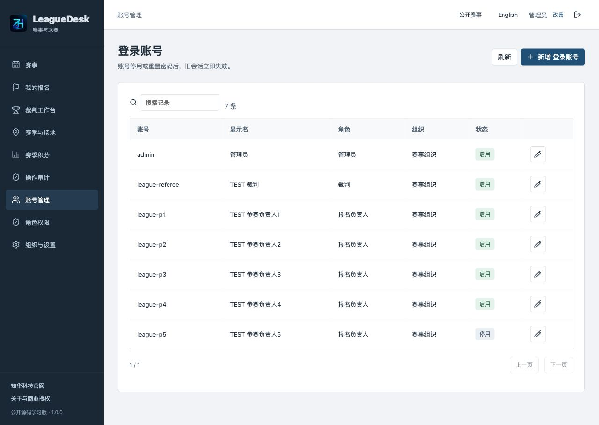
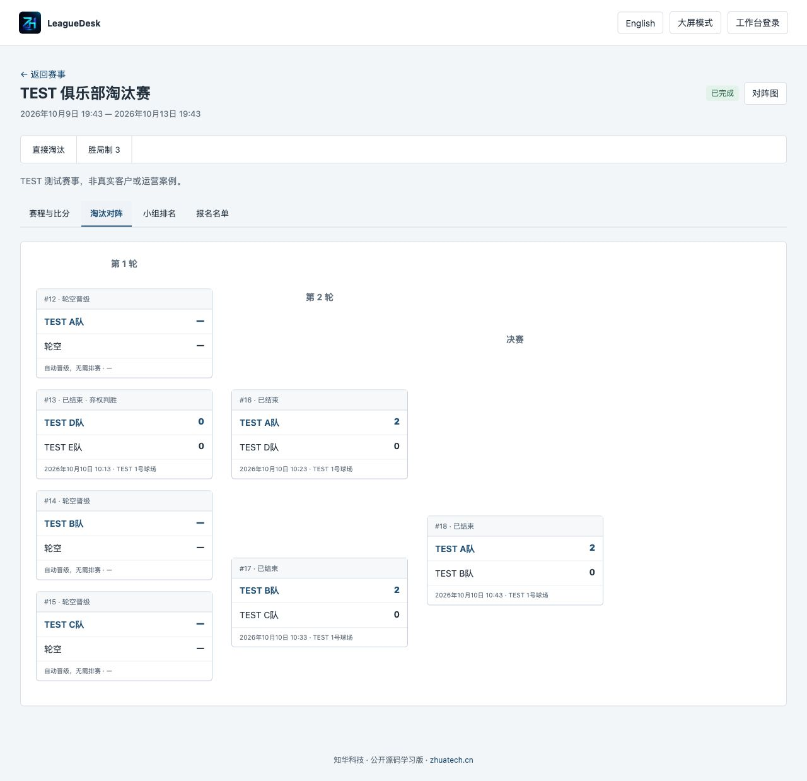
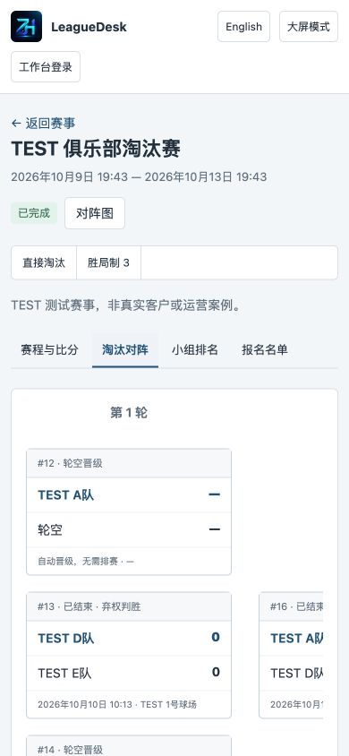

[简体中文](README.md) · [English](README.en.md)

# LeagueDesk · 知华体育赛事与联赛管理系统

知华科技（上海如静知华信息科技有限公司） · [官网](https://www.zhuatech.cn/)

LeagueDesk 管理球馆、俱乐部及社区球类比赛的报名审核、签到、分组循环赛、淘汰晋级、场地与裁判排赛、比分确认和赛季积分。主办工作台、参赛负责人入口、裁判工作台和免登录公开赛程使用同一持久化数据库。Java 21 / Spring Boot 4 / Vue 3 / MySQL 8.4。

**公开源码学习版／非商业源码版**：仅限个人学习交流，未经上海如静知华信息科技有限公司书面授权不得商用。本项目不是允许免费商用的 OSI 开源项目，详见 [LICENSE](LICENSE)。

## 适用场景与业务边界

- 球馆或俱乐部：组织 2–64 个参赛单位的单打赛事，维护赛季和多个场地。
- 社区、校园活动：负责人登录报名，工作人员审核、安排种子并签到，裁判处理本人被指派比赛。
- 比赛现场：发布无需登录的赛程链接，查看小组排名和淘汰签表，可切换大屏显示。

一个报名单位绑定一个负责人账号，显示名可为个人或队伍；系统记录**胜局数**，支持三局两胜、五局三胜、七局四胜。没有队内单打／双打编排、逐球计分或足球积分规则。每个小组 2–16 人；小组按胜场、净胜局、胜局数、种子序排序。该规则与不同体育协会规则可能不同，不能宣称符合全部赛事规程。

## 已实现功能

| 入口 | 可执行业务 |
|---|---|
| 主办人员 | 赛季、场地、赛事草稿；开放报名；代参赛负责人登记；审核、种子顺序、签到；生成循环赛或直接淘汰赛；安排场地、裁判、时间；晋级、比分更正、取消、完成、公开发布；比赛 CSV 导出 |
| 参赛负责人 | 登录查看同组织开放报名赛事；本人报名、查看审核和签到状态、在开放阶段撤回；查看本人参赛赛事与公开成绩；不能审核他人或管理账号 |
| 裁判 | 本人指派比赛工作台；按计划开赛、提交胜局比分或弃权结果；不能修改已提交成绩或操作其他裁判比赛 |
| 管理员 | 上述业务与账号、角色权限、组织、赛事分类、菜单和系统限额管理；修改本人密码；操作审计 |
| 公众 | 已发布赛事、已审核参赛显示名、赛程、成绩、小组排名和淘汰签表；大屏模式；15 秒刷新；不返回负责人账号、报名备注或审计 |

奇数循环赛自动轮休；淘汰赛补足 2 的幂并处理轮空。只有所有小组赛结束后才允许晋级。淘汰赛更正胜方时清除受影响的未开赛下游排赛；下游已开赛禁止更正。完成后冻结成绩。场地、裁判及负责人时间冲突跨赛事检查，相邻时段可排；实际开赛前重新核对有效人员和场地。

赛事命令使用版本号、事务和 UUID 幂等键，重复请求不重复晋级或发布。账号、组织停用与角色修改立即影响后续接口访问。赛季只累计已完成赛事：冠军 5 分、亚军 3 分、其他实际入签者 1 分，这是本地积分口径。

## 当前运行截图

截图来自独立测试数据库，`TEST` 名称为测试录入，不是真实客户案例。安装后的全新数据库不带这些赛事。图片均为实际运行页面。

### 登录页：账号登录和公开赛事入口


### 主办首页：赛事状态、检索和草稿管理


### 业务页：排赛与裁判录分



### 管理页：报名审核、种子与签到


### 统计页：已完成赛事的赛季积分


### 权限页：岗位范围与账号管理



### 公众页：淘汰签表和移动端公开赛程



## 技术架构与目录

浏览器 → Nginx 同源代理 → Spring Boot 会话与业务接口 → MySQL。Vue 页面所有核心记录来自 API；Flyway 负责版本迁移，JPA 仅校验模型，不自动建表。后端用数据库锁串行保护关键写事务，适用于中小规模办赛，不是分布式高并发平台。

```text
backend/src/main/java/cn/zhuatech/leaguedesk/  账号权限、办赛与排赛服务
backend/src/main/resources/db/migration/    V1 账号目录、V2 赛事业务
backend/src/test/                           编排算法及真实接口集成测试
frontend/src/                              中文／英文操作界面
frontend/public/brand/                     原始 LOGO 与两个微信二维码
scripts/                                   初始化、HTTP 验收、备份恢复、发布检查
compose.yaml                               MySQL、后端、前端
compose.dev.yaml                           仅本机数据库调试端口
.github/workflows/verify.yml                构建、MySQL 流程与恢复验证
docs/                                      操作、接口、部署、安全、截图
```

## 环境、安装与数据库初始化

推荐 Docker Engine 27+ / Docker Desktop，Docker Compose v2 支持 `--wait`，4 GB 可用内存，至少 4 GB 磁盘。源码调试需 JDK 21、Maven 3.9+、Node.js **24.19.0+**、npm 和 MySQL 8.4。镜像构建使用 Java 21 和 Node 24.19.0。

```bash
git clone https://github.com/zhuatech-han/zhuatech-leaguedesk.git
cd zhuatech-leaguedesk
python3 scripts/init-env.py
docker compose -p leaguedesk config --quiet
docker compose -p leaguedesk up -d --build --wait --wait-timeout 180
```

打开 <http://127.0.0.1:8144/>。健康检查 <http://127.0.0.1:8144/actuator/health>。管理员账号默认 `admin`，密码从本机生成的 `.env` 中 `ADMIN_PASSWORD` 获取，**没有统一默认密码**。不要公开 `.env` 或在截图里展示密码。

首次启动 V1、V2 迁移创建数据库表，并初始化一个组织、四类角色、权限菜单、赛事分类、限额和管理员。**不初始化业务赛事、参赛人员或裁判账号。** 在管理员中建立参赛负责人和裁判，再创建赛季、场地、赛事；流程见 [操作手册](docs/OPERATIONS.md)。已有数据库重新启动不重置管理员密码。迁移文件提交后不可随意改写；后续结构变化增加新迁移。

## 配置与本机源码调试

| 配置 | 作用 |
|---|---|
| `MYSQL_ROOT_PASSWORD`、`DATABASE_PASSWORD` | 独立 MySQL 强密码；不能留空 |
| `ADMIN_USERNAME`、`ADMIN_PASSWORD` | 首次管理员账号与强密码，密码 12–72 字节，含大写、小写、数字 |
| `WEB_PORT` | 前端端口，默认 8144；占用时改 `.env` 或 `WEB_PORT=8150 docker compose -p leaguedesk up -d` |
| `BIND_ADDRESS` | 默认 `127.0.0.1`，仅本机访问 |
| `COOKIE_SECURE` | 本机 HTTP 为 false；正式 HTTPS 反向代理启用 true |
| `DATABASE_URL`、`DATABASE_USER` | 可选外部 MySQL；外部连接应验证 CA 和主机身份，见部署手册 |
| `MYSQL_DEV_PORT` | 仅调试覆盖文件使用，默认本机 33144 |

```bash
docker compose -p leaguedesk-dev -f compose.yaml -f compose.dev.yaml up -d mysql
python3 scripts/dev-backend.py
# 另一个终端：
cd frontend
npm ci --no-audit --no-fund
npm run dev
```

Vite 本机开发端口 5173，代理后端 8080；生产构建通过 Nginx 服务名代理，不依赖开发地址。勿将调试数据库端口公开。

## 测试

```bash
mvn -B -f backend/pom.xml spotless:check verify
npm --prefix frontend ci --no-audit --no-fund
npm --prefix frontend run format:check
npm --prefix frontend run lint
npm --prefix frontend test
npm --prefix frontend run build
python3 scripts/release-check.py
```

后端 6 项算法／输入测试、19 项集成测试；前端 9 项会话、CSRF 和网络行为测试。另有真实 MySQL 验收：**只对独立本机空库运行**，会添加 `TEST` 赛事和账号，不应对业务数据库执行。

```bash
python3 scripts/quality.py --base http://127.0.0.1:8144
# 重启后核对完整快照：
docker compose -p leaguedesk restart backend
docker compose -p leaguedesk up -d --wait --wait-timeout 180
python3 scripts/verify-persistence.py
```

Docker 后端构建实际运行测试，没有跳过测试。完整验证范围、复测和边界见 [测试说明](docs/TESTING.md)。

## 部署、备份与恢复

使用正式域名、HTTPS 反向代理、私有数据库网络和 `COOKIE_SECURE=true`；配置限流、日志轮转、磁盘与备份监控。不要把本机测试直接称作生产认证。端口、证书、会话及外部数据库说明见 [部署手册](docs/DEPLOYMENT.md)。

```bash
python3 scripts/backup.py --project leaguedesk --output /private/path/leaguedesk-backup.zip
# 仅恢复到全新独立项目；新环境文件设置不同的 WEB_PORT：
python3 scripts/restore.py /private/path/leaguedesk-backup.zip --project leaguedesk-restore --env-file /private/path/restore.env
```

备份短暂停止后端写入，完成后自动启动。包含数据库和密码散列，必须保密；恢复拒绝覆盖已有容器、网络和卷，只信任自己生成的备份。测试环境才使用 `docker compose -p leaguedesk-test down -v` 删除专用测试卷；业务环境停机用 `stop` 或 `down` 保留数据库卷。

## 已知限制与第三方配置

- 首版不含自动智能排程、瑞士轮、双败赛、队内人员编排、逐球计分、运动协会官方排名或积分接口。
- 不含短信、支付收费、直播、硬件计分、离线同步、多公司租户 SaaS、自助注册和忘记密码邮件。主办方创建参赛账号；无账号的人只能看公开页面。
- 时间存 UTC，输入和显示按浏览器时区；排赛需核对页面时区提示。
- 取消和完成保留历史，不提供删除已执行赛事或随意回滚成绩。已生成淘汰赛的小组结果、已开赛下游的上游结果禁止更正。
- 最多 64 个入签单位，每小组最多 16 人；系统采用串行写锁，未经大规模并发与外部攻击测试。
- 数据目录读取有 10,000 条保护上限，审计最多返回最近 1,000 条。需要长期大规模运营可定制服务端分页、归档和审计留存策略。
- 核心功能无短信或支付账户依赖。正式部署需配置域名、TLS、可靠 MySQL 与备份；不含第三方集成的虚构完成项。

## 授权、依赖与联系知华科技

自有代码依 [LICENSE](LICENSE) 仅限个人学习、技术研究与非商业交流。商业授权、企业部署、二次销售或收费服务须先获书面授权。第三方依赖保留各自版权与许可证，见 [第三方说明](docs/THIRD_PARTY.md)，本项目许可不覆盖第三方。

[知华科技官网](https://www.zhuatech.cn/) · 微信 `zhuatech`、`zhuatech2`。商业授权或深度定制开发请联系知华科技。服务包括源码授权、定制开发、部署和系统集成。

<table><tr><td align="center"><br/>zhuatech</td><td align="center"><br/>zhuatech2</td></tr></table>
